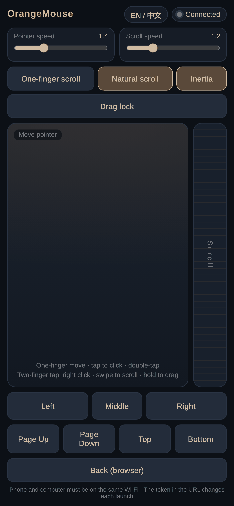
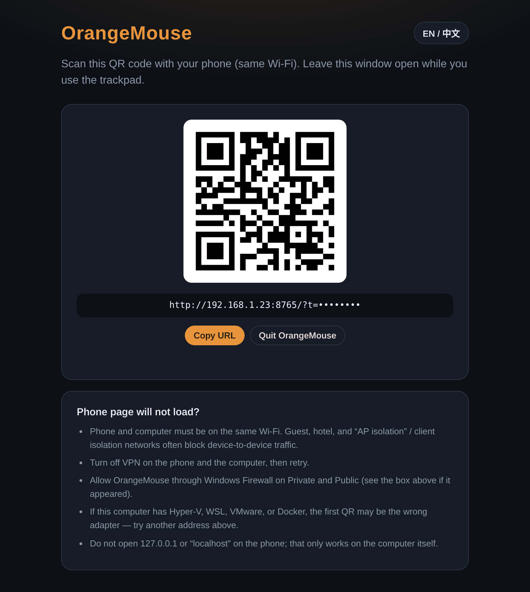

# OrangeMouse

English | [简体中文](README.zh-CN.md)

Use your phone as a wireless trackpad for your Windows or Mac computer. Run OrangeMouse on the computer, open the page on your phone (same Wi-Fi), and move the cursor, click, drag, and scroll — no app install on the phone.

<p align="center">
  
  
</p>


## Download

The easiest way is to grab a build from [Releases](https://github.com/iamorangedad/OrangeMouse/releases):

- **Windows:** `OrangeMouse.exe`
- **macOS:** `OrangeMouse.dmg` (Apple Silicon / arm64; Intel Macs may need Rosetta)

The packaged app opens your browser to a local page with a QR code and the phone URL. Leave that page open while you use the trackpad. A console window on Windows is normal.

### Windows: SmartScreen

Because the exe is not code-signed, Windows may show **Windows protected your PC**.

1. Click **More info**.
2. Click **Run anyway**.

The first time, Windows Firewall may ask for permission. Allow OrangeMouse on **Private and Public** networks. The packaged app tries to add an allow rule for TCP port 8765; if that fails (it needs Administrator), the setup page shows a command you can copy into an Administrator PowerShell.

If this computer has Hyper-V, WSL, VMware, or Docker, the setup page lists every local address with its own QR code. Prefer a **192.168.x** or **10.x** address; **172.x** is often a virtual adapter, not your Wi-Fi.

### macOS: unsigned app, then Accessibility

The app is not notarized or signed with an Apple Developer ID.

1. Open `OrangeMouse.dmg` and drag **OrangeMouse** to Applications (or run it from the disk image).
2. If macOS says the app can’t be opened: **right-click** (or Control-click) **OrangeMouse** → **Open** → **Open**. You only need to do this once.
3. If that still fails, remove the quarantine flag in Terminal, then open the app again:

```bash
xattr -dr com.apple.quarantine /Applications/OrangeMouse.app
```

4. Grant **Accessibility** permission, or the pointer will not move:
   - **System Settings → Privacy & Security → Accessibility**
   - Enable **OrangeMouse** (or add it with **+**).
   - Quit OrangeMouse and start it again after changing the permission.

If you already denied it, turn the switch off and on, or remove OrangeMouse from the list and add it again.

## Gestures and buttons

- **One-finger drag:** move the cursor (adjustable speed)
- **Tap:** left click
- **Double-tap:** double click
- **Two-finger tap:** right click
- **Press and hold, then drag**, or turn on **Drag lock:** left-button drag
- **Two-finger swipe:** scroll (optional inertia and natural scrolling)
- **Right-edge strip:** one-finger scroll
- **One-finger scroll** mode: the whole pad scrolls with one finger
- On-screen buttons: **Left** (can be held), **Middle**, **Right**, **Page Up**, **Page Down**, **Top**, **Bottom**, and **Back** (browser back: Alt+← on Windows, ⌘+← on Mac)

The phone page has an **EN / 中文** switch. It follows your phone language the first time (`zh*` → Chinese, otherwise English) and remembers your choice.

## Run from source

You need **Python 3.10+**.

### Windows: install Python

1. Download the installer from [python.org](https://www.python.org/downloads/windows/).
2. On the first installer screen, check **Add python.exe to PATH**, then click **Install Now**.
3. Close and reopen Command Prompt or PowerShell, then check:

```bat
python --version
```

If `python` is not recognized, Python is not on PATH — run the installer again and enable that checkbox.

### Create a virtual environment and install

```bash
cd OrangeMouse
```

**macOS / Linux:**

```bash
python3 -m venv .venv
source .venv/bin/activate
pip install -r requirements.txt
python server.py
```

**Windows (Command Prompt):**

```bat
py -3 -m venv .venv
.venv\Scripts\activate.bat
pip install -r requirements.txt
python server.py
```

**Windows (PowerShell):**

```powershell
py -3 -m venv .venv
.venv\Scripts\Activate.ps1
pip install -r requirements.txt
python server.py
```

If PowerShell blocks the activate script, run `Set-ExecutionPolicy -Scope CurrentUser RemoteSigned`, or use Command Prompt.

On macOS, grant Accessibility to **Terminal** (or iTerm, VS Code, Cursor, or the Python interpreter you actually used), then restart `python server.py`.

### Command-line options

```bash
python server.py --port 8765
python server.py --dry-run       # print actions; do not move the real mouse
python server.py --no-browser    # do not open the local setup page
```

Click the window you want to control first. Scan the QR code, or open the printed URL on your phone — it must include `?t=...`. Press Ctrl+C to quit. The token changes every launch, so scan again next time.

Dependencies: `aiohttp` (web + WebSocket), `pynput` (mouse and keyboard), `qrcode` (QR codes), `psutil` (lists network adapters so the correct Wi-Fi address can be chosen).

## Security

Use OrangeMouse only on a network you trust. Each start creates a random token in the URL; without it, the page and WebSocket are rejected. Traffic is plain HTTP (not encrypted). Do not post or share the link.

The local setup page’s Quit button only works from the computer itself (`127.0.0.1`).


## Troubleshooting: the phone cannot open the page

This is the most common problem on Windows after scanning the QR code.

1. **Same Wi-Fi.** Phone and computer must be on the same network. Guest, hotel, and many “smart” routers with **AP isolation** / client isolation block device-to-device traffic. Try a normal (non-guest) Wi-Fi, or a phone hotspot that both use.
2. **Turn VPN off** on the phone and the computer, then scan again.
3. **Wrong address.** The setup page (and the terminal) list every IPv4 address. Scan the QR for a **192.168.x** or **10.x** address. Skip **172.16–31.x** if you have Hyper-V, WSL, or Docker, and skip anything labeled as a virtual adapter.
4. **Windows Firewall.** Allow OrangeMouse on **Private and Public**:
   - Windows Security → Firewall & network protection → Allow an app through firewall → OrangeMouse (check both boxes), or
   - Run this in **PowerShell as Administrator** (change the path if needed; the setup page has a one-click copy with the real path):

```powershell
netsh advfirewall firewall add rule name="OrangeMouse" dir=in action=allow enable=yes profile=private,public program="C:\path\to\OrangeMouse.exe" protocol=TCP localport=8765
```

5. Do **not** open `http://127.0.0.1:...` on the phone. That address only works on the computer itself.
6. OrangeMouse listens on **0.0.0.0:8765** (all interfaces) by default. The local setup page on the computer should still open even when the phone cannot; if even that fails, the app did not start correctly.

## Limitations

- Phone and computer must be on the **same Wi-Fi**. Guest networks and AP isolation often block device-to-device traffic.
- The packaged macOS build is **Apple Silicon (arm64)**.
- Windows scrolling can feel notchy (wheel ticks); macOS is usually smoother.
- **Back** sends a browser-style shortcut, not a universal Back key.
- The app is unsigned, so SmartScreen and Gatekeeper warnings are expected until you allow it once.

## License

[MIT](LICENSE) © 2026 iamorangedad
