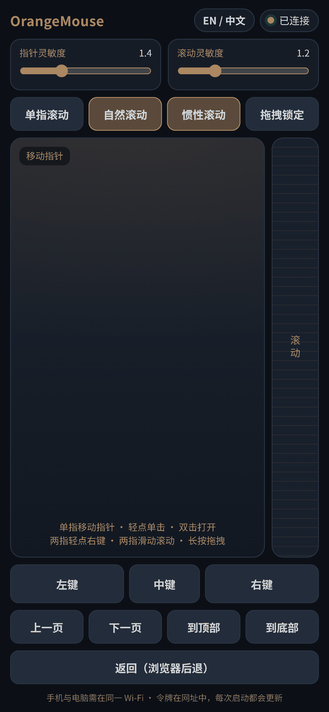

# OrangeMouse

[English](README.md) | 简体中文

把手机当成电脑的无线触控板。在 Windows 或 Mac 上运行 OrangeMouse，用手机浏览器打开同一 Wi-Fi 下的页面，就能移动指针、点击、拖拽和滚动，手机不用安装 App。

<p align="center">
  
  
</p>


## 下载

最方便的方式是从 [Releases](https://github.com/iamorangedad/OrangeMouse/releases) 下载已经打包好的版本：

- **Windows：** `OrangeMouse.exe`
- **macOS：** `OrangeMouse.dmg`（Apple Silicon / arm64；Intel 电脑可能需要 Rosetta）

打包版启动后会在电脑浏览器里打开一个本机页面，显示二维码和手机网址。使用触控板时请保持该页面打开。Windows 上出现一个控制台窗口是正常的。

### Windows：SmartScreen

安装包没有代码签名，Windows 可能提示「Windows 已保护你的电脑」。

1. 点击 **更多信息**。
2. 再点击 **仍要运行**。

第一次运行时，防火墙也可能弹出提示。请在**专用和公用**网络上都允许 OrangeMouse。打包版会尝试自动添加 TCP 8765 端口的放行规则；如果失败（需要管理员权限），本机页面上会给出一条可复制的命令，请在「管理员 PowerShell」中运行。

如果这台电脑装了 Hyper-V、WSL、VMware 或 Docker，本机页面会列出所有地址，每个都有自己的二维码。请优先用 **192.168.x** 或 **10.x**；**172.x** 常常是虚拟网卡，不是家里的 Wi-Fi。

### macOS：未签名应用，以及辅助功能权限

应用未经 Apple 开发者账号签名，也没有公证。

1. 打开 `OrangeMouse.dmg`，把 **OrangeMouse** 拖到「应用程序」，或直接从磁盘映像运行。
2. 若系统提示无法打开：先**右键**（或按住 Control 点击）**OrangeMouse** → **打开** → 再点 **打开**。只需做一次。
3. 若仍然被拦截，可在「终端」里去掉隔离属性，然后再打开：

```bash
xattr -dr com.apple.quarantine /Applications/OrangeMouse.app
```

4. 必须打开**辅助功能**权限，否则指针不会动：
   - **系统设置 → 隐私与安全性 → 辅助功能**
   - 打开 **OrangeMouse**（或用 **+** 添加）
   - 改完权限后请退出再重新打开 OrangeMouse

如果曾经点过拒绝，可以把开关关掉再打开，或从列表中删除后再添加一次。

## 手势与按钮

- **单指滑动：** 相对移动鼠标指针（可调灵敏度）
- **轻点：** 左键单击
- **快速连点两下：** 双击
- **两指轻点：** 右键
- **长按后拖动**，或打开「拖拽锁定」：按住左键拖拽
- **两指滑动：** 滚动（可选惯性滚动 / 自然滚动）
- **右侧滚动条：** 单指专门用来滚动
- **「单指滚动」模式：** 整个触控区单指滑动即滚动
- 屏幕按钮：**左键**（可按住）、**中键**、**右键**，以及 **上一页**、**下一页**、**到顶部**、**到底部**、**返回**（浏览器后退：Windows 为 Alt+←，Mac 为 ⌘+←）

手机页面有 **EN / 中文** 切换。第一次会按手机系统语言选择（`zh*` 为中文，否则为英文），并记住你的选择。

## 从源码运行

需要 **Python 3.10+**。

### Windows：安装 Python

1. 从 [python.org](https://www.python.org/downloads/windows/) 下载安装程序。
2. 在安装程序第一屏勾选 **Add python.exe to PATH**，然后点击 **Install Now**。
3. 关闭并重新打开「命令提示符」或 PowerShell，检查：

```bat
python --version
```

如果提示找不到 `python`，说明没有加入 PATH，请重新运行安装程序并勾选该项。

### 创建虚拟环境并安装

```bash
cd OrangeMouse
```

**macOS / Linux：**

```bash
python3 -m venv .venv
source .venv/bin/activate
pip install -r requirements.txt
python server.py
```

**Windows（命令提示符）：**

```bat
py -3 -m venv .venv
.venv\Scripts\activate.bat
pip install -r requirements.txt
python server.py
```

**Windows（PowerShell）：**

```powershell
py -3 -m venv .venv
.venv\Scripts\Activate.ps1
pip install -r requirements.txt
python server.py
```

如果 PowerShell 无法加载激活脚本，可先执行 `Set-ExecutionPolicy -Scope CurrentUser RemoteSigned`，或改用命令提示符。

在 macOS 上，请给**终端**（或 iTerm、VS Code、Cursor，或你实际使用的 Python）开启辅助功能权限，然后重新运行 `python server.py`。

### 常用参数

```bash
python server.py --port 8765
python server.py --dry-run       # 演练模式：只打印动作，不移动真鼠标
python server.py --no-browser    # 不自动打开本机页面
```

先用鼠标点一下要控制的窗口。扫描二维码，或在手机浏览器打开完整网址（必须带 `?t=...`）。用完按 Ctrl+C 结束。每次启动令牌都会变，需要重新扫码。

依赖：`aiohttp`（网页和 WebSocket）、`pynput`（控制鼠标键盘）、`qrcode`（二维码）、`psutil`（列出网卡，以便选中正确的 Wi-Fi 地址）。

## 安全说明

请只在自己信任的局域网使用。每次启动都会在网址里生成随机令牌，没有令牌无法打开页面或连接。通信是普通 HTTP，没有加密。不要把带令牌的网址发到网上。

本机页面上的「退出」按钮只能从这台电脑自己访问（`127.0.0.1`）。


## 故障排除：手机扫码后一直打不开页面

这是 Windows 上最常见的问题。

1. **同一个 Wi-Fi。** 手机和电脑必须在同一网络。访客、酒店网络，以及许多开了 **AP 隔离** / 客户端隔离的路由器，会禁止设备互访。请改用普通（非访客）Wi-Fi，或用手机热点让两端一起连。
2. **关掉 VPN**（手机和电脑都关），然后再扫一次。
3. **扫错了地址。** 本机页面和终端会列出所有 IPv4 地址。请扫 **192.168.x** 或 **10.x** 的二维码。如果电脑有 Hyper-V、WSL 或 Docker，请尽量不要扫 **172.16–31.x**，也不要扫标注为虚拟网卡的地址。
4. **Windows 防火墙。** 请在**专用和公用**网络上都允许 OrangeMouse：
   - Windows 安全中心 → 防火墙和网络保护 → 允许应用通过防火墙 → OrangeMouse（两个框都勾选），或
   - 在**管理员 PowerShell** 中运行下面的命令（请按实际路径修改；本机页面上的「复制防火墙命令」会带上正确路径）：

```powershell
netsh advfirewall firewall add rule name="OrangeMouse" dir=in action=allow enable=yes profile=private,public program="C:\path\to\OrangeMouse.exe" protocol=TCP localport=8765
```

5. **不要**在手机上打开 `http://127.0.0.1:...`。这个地址只能在电脑本机访问。
6. OrangeMouse 默认监听 **0.0.0.0:8765**（所有网卡）。电脑上的本机设置页即使手机连不上通常也能打开；如果连这个页都打不开，说明程序没有正常启动。

## 限制

- 手机和电脑必须在**同一个 Wi-Fi**。访客网络和 AP 隔离常常会禁止设备互访。
- 打包的 macOS 版本面向 **Apple Silicon（arm64）**。
- Windows 上的滚动可能有「一格一格」的手感（滚轮刻度）；macOS 通常更顺。
- 「返回」发送的是浏览器后退快捷键，不是通用的 Back 键。
- 应用未经签名，因此 SmartScreen 和 Gatekeeper 的提示是预期现象，允许一次即可。

## 许可

[MIT](LICENSE) © 2026 iamorangedad
